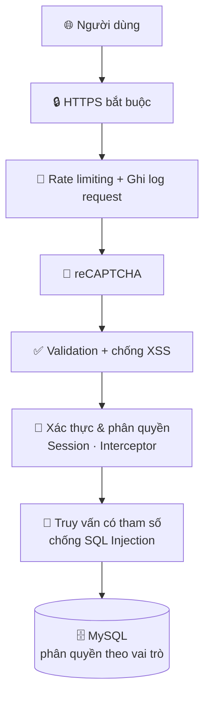

# 💻 LapFarm – Website bán laptop "an toàn từ trong ra ngoài"

**LapFarm** là website thương mại điện tử bán máy tính xách tay, được xây dựng như một đề tài về **bảo mật ứng dụng web**. Ngoài các chức năng mua bán quen thuộc (xem sản phẩm, giỏ hàng, thanh toán, quản trị), dự án tập trung chứng minh cách **phòng thủ nhiều tầng** trước các kiểu tấn công phổ biến: *XSS, SQL Injection, IDOR, brute-force đăng nhập, lộ dữ liệu trên đường truyền*...

> 📘 Đề tài: *"Xây dựng website bán máy tính xách tay đảm bảo an toàn bảo mật"*

---

## 🎯 Dự án này có gì?

| 🛍 Mua sắm | 🛡 Bảo mật | 🧑‍💼 Quản trị |
|---|---|---|
| Duyệt sản phẩm theo danh mục / thương hiệu | Khoá tài khoản khi nhập sai mật khẩu | Quản lý sản phẩm, danh mục, thương hiệu |
| Tìm kiếm, xem chi tiết, đánh giá sao | reCAPTCHA + mã xác minh qua email | Xử lý đơn hàng, gửi thông báo tự động |
| Giỏ hàng đồng bộ với tài khoản | Mã hoá ID trên URL chống IDOR | Khoá / mở khoá người dùng, xem lịch sử |
| Thanh toán online qua **VNPay** | Lọc XSS, kiểm tra dữ liệu đầu vào | Xem lịch sử thanh toán |
| Nhận thông báo khi đơn đổi trạng thái | HTTPS bắt buộc, phân quyền DB nhiều tầng | Tìm kiếm trong từng trang quản trị |

---

## 🛡 Các lớp bảo vệ



**Xác thực & phiên**
- Đăng nhập kèm **Google reCAPTCHA**, hoặc đăng nhập bằng **Google OAuth2**.
- Sai mật khẩu **3 lần → khoá tài khoản 10 phút**.
- Nhắc **đổi mật khẩu sau 90 ngày**.
- Mật khẩu mạnh: ≥ 8 ký tự, có chữ hoa, chữ thường, số và ký tự đặc biệt.
- Đăng ký, quên mật khẩu, đổi mật khẩu đều yêu cầu **mã xác minh 6 ký tự gửi qua email** (hiệu lực 10 phút).
- Session hết hạn sau 120 phút; vùng `/admin/**` chỉ cho phép tài khoản admin.

**Chống tấn công**
- **IDOR:** ID sản phẩm, đơn hàng, thông báo trên URL được **mã hoá AES** (`SecureUrlUtil`) – người dùng không thể đoán hay sửa ID để xem dữ liệu người khác.
- **XSS:** lọc và escape dữ liệu (`XSSUtils`, `ValidationUtils`) ở form thanh toán, đánh giá, hồ sơ.
- **SQL Injection:** dùng truy vấn HQL có tham số (`setParameter`).
- **Brute-force / DoS nhẹ:** `RateLimitingFilter` áp dụng cho mọi URL.
- **Giám sát:** `RequestLoggingFilter` ghi IP và giao thức của từng request.
- **Upload:** giới hạn dung lượng file 3 MB.

**Phân quyền cơ sở dữ liệu**
Ứng dụng kết nối MySQL bằng **3 tài khoản khác nhau** (`root`, `user`, `visitor`) tương ứng 3 mức quyền, để một lỗ hổng ở phía khách không thể chạm tới toàn bộ dữ liệu.

---

## 🧰 Công nghệ

| Lớp | Công nghệ |
|---|---|
| Backend | Java, Spring MVC (cấu hình XML), Hibernate 5 |
| Giao diện | JSP, CSS, JavaScript, AdminLTE (trang quản trị) |
| CSDL | MySQL |
| Server | Apache Tomcat 10+ (Jakarta EE, `web.xml` version 6.0) |
| Tích hợp | VNPay (sandbox), Google OAuth2, Google reCAPTCHA, JavaMail (Gmail SMTP) |
| Log | Log4j / Logback |

---

## 🗂 Cấu trúc mã nguồn

```
src/main/
├── java/LapFarm/
│   ├── Controller/    # Login, Signup, Account, Cart, Payment, Admin, Product, Review...
│   ├── Service/       # Nghiệp vụ: giỏ hàng, đơn hàng, thanh toán, Google login...
│   ├── DAO/           # Truy cập dữ liệu (Hibernate)
│   ├── Entity/        # Ánh xạ bảng: account, userinfo, product, orders, review...
│   ├── DTO/           # Đối tượng truyền dữ liệu
│   ├── Filter/        # RateLimitingFilter, RequestLoggingFilter
│   ├── Interceptor/   # Đồng bộ giỏ hàng, chặn truy cập /admin, chặn đăng nhập lặp
│   ├── Utils/         # SecureUrlUtil (AES), ValidationUtils, XSSUtils
│   └── Bean/Mailer    # Gửi mã xác minh qua email
└── webapp/WEB-INF/
    ├── configs/       # Cấu hình Spring (MVC, DataSource, mail, Google)
    ├── security/      # keystore.jks (HTTPS)
    ├── resources/     # CSS, JS, ảnh, giao diện admin
    └── views/         # Trang JSP (user, admin, payment, notifications...)
```

---

## 🚀 Chạy thử

### 1. Chuẩn bị
- JDK 17+ và **Tomcat 10+** (dự án dùng Jakarta Servlet 6.0)
- **MySQL** chạy ở cổng `3306`
- IDE hỗ trợ Dynamic Web Project (Eclipse / IntelliJ)
- Các thư viện Spring, Hibernate 5, MySQL Connector/J, JavaMail, Gson, SLF4J… (repo chưa có file build, hãy thêm vào `WEB-INF/lib` hoặc cấu hình Maven/Gradle)

### 2. Tạo cơ sở dữ liệu
Tạo database rỗng tên **`lapfarm`**. Hibernate được cấu hình `hbm2ddl.auto=update` nên sẽ tự tạo các bảng khi ứng dụng chạy lần đầu. Sau đó tạo 3 tài khoản MySQL (`root`, `user`, `visitor`) với quyền phù hợp và điền vào `spring-config-mvc.xml`.

> ℹ️ Repo chưa kèm script dữ liệu mẫu, bạn cần tự thêm các vai trò (`role`: 0 = người dùng, 1 = admin), danh mục, thương hiệu và sản phẩm đầu tiên.

### 3. Cấu hình
Mở `src/main/webapp/WEB-INF/configs/` và điền thông tin của **bạn**:

| File | Cần cấu hình |
|---|---|
| `spring-config-mvc.xml` | Thông tin 3 tài khoản MySQL, **Google OAuth** (`clientId`, `clientSecret`, `redirectUri`) |
| `spring-config-bean.xml` | Tài khoản Gmail + **App Password** để gửi mã xác minh |
| `Model/Config.java` | Mã website và khoá bí mật VNPay (sandbox), URL trả về |
| `Utils/SecureUrlUtil.java` | Khoá AES dùng để mã hoá ID |
| Các Controller đăng nhập / đăng ký | Khoá bí mật reCAPTCHA |

### 4. Bật HTTPS
`web.xml` yêu cầu toàn bộ trang chạy qua HTTPS (`CONFIDENTIAL`). Hãy khai báo connector HTTPS trong `server.xml` của Tomcat, trỏ tới `WEB-INF/security/keystore.jks`. Địa chỉ mặc định theo cấu hình Google OAuth: `https://localhost:8433/LapFarm/`.

### 5. Chạy
Deploy lên Tomcat với context path **`LapFarm`** rồi mở trình duyệt.

---

## 🔗 Đường dẫn chính

| Đường dẫn | Chức năng |
|---|---|
| `/home`, `/pages`, `/search` | Trang chủ, cửa hàng, tìm kiếm |
| `/products-category`, `/products-brand` | Lọc theo danh mục, thương hiệu |
| `/product-detail/{id}` | Chi tiết sản phẩm & đánh giá |
| `/cart`, `/payment` | Giỏ hàng, thanh toán (có VNPay) |
| `/login`, `/signup`, `/forgot-password` | Đăng nhập, đăng ký, quên mật khẩu |
| `/account`, `/profile`, `/payment-history` | Tài khoản, hồ sơ, lịch sử thanh toán |
| `/admin/home` | Trang quản trị |
| `/admin/product`, `/categories`, `/brands` | Quản lý sản phẩm, danh mục, thương hiệu |
| `/admin/orders`, `/admin/payments` | Xử lý đơn hàng, xem thanh toán |
| `/admin/manage-user` | Quản lý và khoá / mở khoá người dùng |

**Vòng đời đơn hàng:** `Chờ lấy hàng → Đang giao hàng → Hoàn thành` (hoặc `Đã hủy`). Mỗi lần admin đổi trạng thái, khách nhận một thông báo trong tài khoản.

---

## ⚠️ Trước khi đưa lên môi trường thật

Đây là dự án học tập, một số điểm cần củng cố nếu triển khai thực tế:

- **Không để bí mật trong mã nguồn:** mật khẩu DB, mật khẩu email, khoá VNPay / Google / reCAPTCHA / AES nên chuyển sang biến môi trường hoặc file cấu hình ngoài Git, và **đổi mới** những khoá đã từng commit.
- **Băm mật khẩu:** hiện dùng MD5; nên chuyển sang **BCrypt** hoặc **Argon2** có salt.
- **Mã hoá ID:** nên dùng AES chế độ có IV (ví dụ AES-GCM) thay vì chế độ mặc định.
- Nên tắt `hibernate.show_sql` và `hbm2ddl.auto=update` khi chạy thật.

---

## 📄 Tài liệu

Báo cáo đề tài trình bày cơ sở lý thuyết và thực nghiệm về: **IDOR**, **tấn công xác thực**, **XSS**, **SQL Injection**, mã hoá AES, xác thực hai yếu tố, quản lý phiên và phân quyền trong cơ sở dữ liệu.
